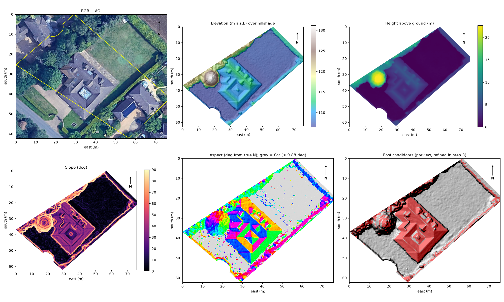

# Roof Reconstruction & Solar Panel Placement

Rebuilds a geometrically consistent 3D roof from a **Digital Surface Model (DSM)** and **RGB aerial
imagery**, finds rooftop obstructions (chimneys, skylights, roof windows), and places standard-size
solar panels on the usable roof area.

> **Status:** in progress. Pipeline steps are added one at a time; see [Pipeline status](#pipeline-status)
> and [`docs/progress.md`](docs/progress.md).

---

## Contents
1. [Pipeline overview](#pipeline-overview)
2. [Repository structure](#repository-structure)
3. [Requirements](#requirements)
4. [Setup](#setup)
5. [Input data](#input-data)
6. [Running the solution](#running-the-solution)
7. [Outputs](#outputs)
8. [Configuration](#configuration)
9. [Testing & code quality](#testing--code-quality)
10. [Technical explanation](#technical-explanation)
11. [Pipeline status](#pipeline-status)

---

## Pipeline overview

```
 DSM + RGB
    │
    ▼
 1. Terrain analysis ──── elevation, slope, aspect (azimuth)
    │
    ▼
 2. Cleaning ──────────── noise removal, fill missing (NoData) pixels
    │
    ▼
 3. Roof faces ────────── segment faces, fit a plane per face, consistent surface
    │
    ▼
 4. Obstructions ──────── chimneys / skylights / windows → excluded from usable area
    │
    ▼
 5. 3D model ──────────── triangulated roof mesh (interactive + exported)
    │
    ▼
 6. Solar layout ──────── standard panels packed on suitable faces, avoiding obstructions
```

## Repository structure

```
.
├── configs/
│   └── default.yaml        # every threshold and parameter (no magic numbers in code)
├── data/
│   └── raw/                # input rasters (read-only)
├── docs/
│   ├── Technical Assessment.pdf
│   ├── assessment/         # brief split by section (objective, data, tasks, ...)
│   ├── figures/            # figures used in the write-up
│   └── progress.md         # per-step log: decisions, outputs, assumptions
├── notebooks/              # exploration only (no pipeline logic)
├── outputs/                # generated results (git-ignored, reproducible)
├── scripts/                # command-line entry points
├── src/roofsolar/          # library: one module per pipeline stage
├── tests/                  # pytest unit tests
├── pyproject.toml          # package metadata, dependencies, tool config
└── requirements.txt        # exact pinned versions for reproducibility
```

## Requirements

- **Python 3.10 to 3.12** (developed on 3.12.13). 3.13+ is not supported yet because `open3d` has no wheels for it.
- macOS / Linux / Windows
- [`uv`](https://docs.astral.sh/uv/) recommended (plain `pip` also works)

Main dependencies:

| Package | Used for |
|---|---|
| `numpy`, `scipy` | array maths, filtering, interpolation, least squares |
| `rasterio` | reading GeoTIFFs, CRS and geotransform handling |
| `scikit-image`, `opencv-python-headless` | image processing, morphology, edges, contours |
| `scikit-learn` | RANSAC, clustering |
| `shapely` | 2D polygon geometry (usable area, panel placement) |
| `open3d`, `trimesh` | 3D point clouds, plane segmentation, meshes |
| `matplotlib`, `plotly` | static and interactive visualisation |
| `pyyaml` | configuration |

The full pinned list is in [`requirements.txt`](requirements.txt).

## Setup

```bash
# 1. Clone
git clone <repo-url>
cd powerlabs_assessment

# 2. Create and activate a virtual environment
uv venv --python 3.12 .venv
source .venv/bin/activate          # Windows: .venv\Scripts\activate

# 3. Install (editable package + dev tools)
uv pip install -e ".[dev]"
```

<details>
<summary>Without uv (plain pip)</summary>

```bash
python3.12 -m venv .venv
source .venv/bin/activate
pip install -r requirements.txt     # exact versions
pip install -e . --no-deps
```
</details>

Check the install:

```bash
python -c "import roofsolar, rasterio, open3d, shapely; print('ok')"
```

## Input data

Stored in `data/raw/`, all on the same 0.1 m grid in **WGS 84 / UTM zone 30N (EPSG:32630)**:

| File | Description | Size (px) | NoData |
|---|---|---|---|
| `dsm_clipped.tif` | DSM clipped to the building (heights in m) | 757 × 623 | -9999 |
| `dsm_full.tif` | DSM of the full scene | 797 × 802 | none |
| `rgb.tif` | RGB orthophoto, aligned with `dsm_full.tif` | 797 × 802 | 0 |

## Running the solution

```bash
source .venv/bin/activate

# Full pipeline (all implemented steps)
python scripts/run_pipeline.py

# A single step, or a custom config
python scripts/run_pipeline.py --steps 1
python scripts/run_pipeline.py --config configs/my_config.yaml

# Cross-check slope/aspect against GDAL (needs gdaldem; QGIS's copy is found automatically)
python scripts/validate_terrain_gdal.py
```

## Outputs

All results go to `outputs/` (git-ignored; rerun the pipeline to regenerate them). Each step
writes to its own `stepNN_*` subfolder. GeoTIFFs keep the input georeferencing, so they open
directly in QGIS.

**Step 1: `outputs/step01_terrain/`**

| File | Content |
|---|---|
| `elevation.tif` | DSM heights in the area of interest (m a.s.l.) |
| `slope.tif` | slope (deg), Horn's method |
| `aspect.tif` | facing direction (deg clockwise from **true** north); NaN where flat |
| `normals.tif` | unit surface normals, 3 bands (east, north, up) |
| `dtm.tif`, `ndsm.tif` | estimated ground height and height above ground (m) |
| `stats.json` | grid info, noise estimates, flat threshold, roof aspect peaks |
| `00_summary.png` … `06_data_provenance.png` | figures |



## Configuration

All parameters (slope limits, obstruction height threshold, panel dimensions, setbacks, ...) live in
[`configs/default.yaml`](configs/default.yaml). To run with different settings, copy the file and
pass it with `--config`.

## Testing & code quality

```bash
pytest              # unit tests
ruff check .        # lint
ruff format .       # format
```

## Technical explanation

The approach, key algorithms, assumptions, limitations and incomplete tasks will be documented in
`docs/technical_report.md` as the work progresses. Per-step decisions are logged in
[`docs/progress.md`](docs/progress.md).

## Pipeline status

| Step | Status |
|---|---|
| 1. Terrain analysis (elevation, slope, aspect) | ✅ |
| 2. Cleaning (noise, missing data) | ⏳ next |
| 3. Roof face segmentation & plane fitting | ⬜ |
| 4. Obstruction detection | ⬜ |
| 5. 3D roof model | ⬜ |
| 6. Solar panel placement | ⬜ |
| 7. Validation & write-up | ⬜ |
