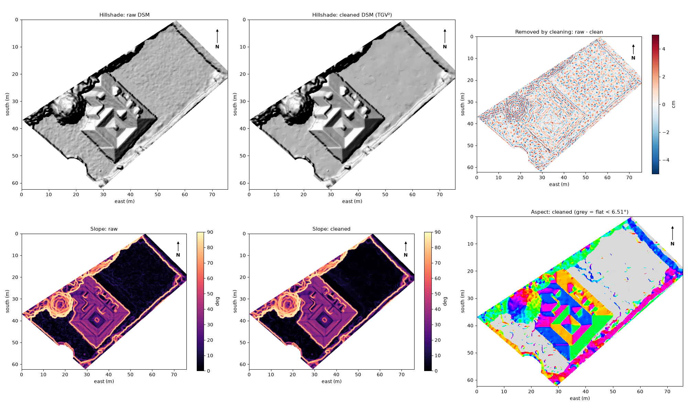
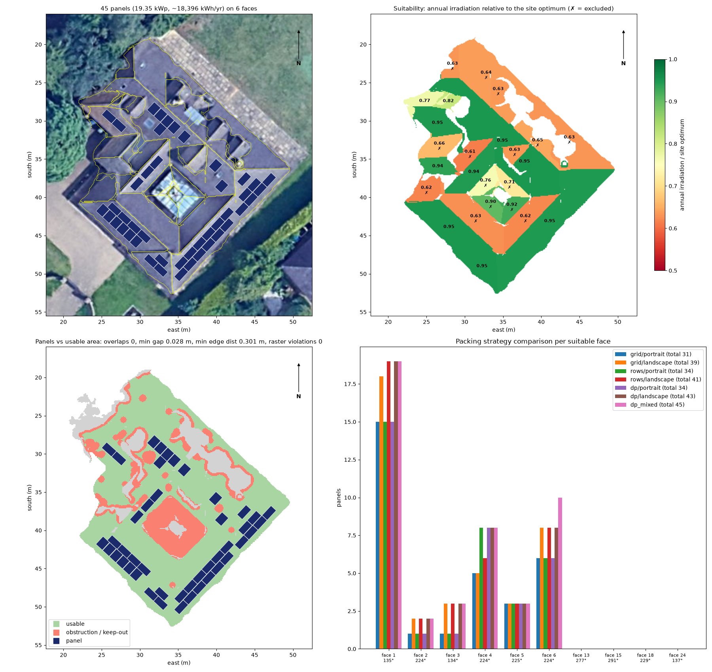
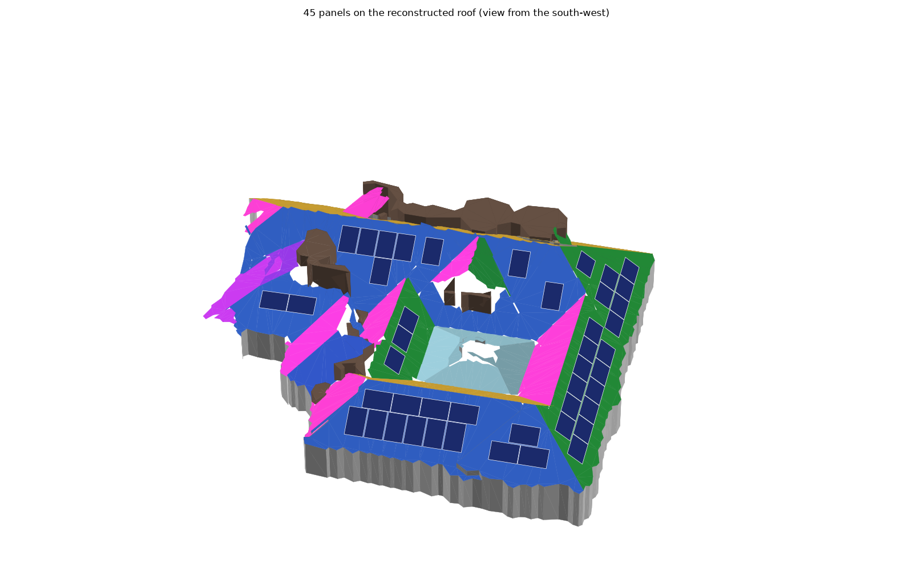

# Roof Reconstruction & Solar Panel Placement

Rebuilds a geometrically consistent 3D roof from a **Digital Surface Model (DSM)** and **RGB aerial
imagery**, finds rooftop obstructions (chimneys, skylights, roof windows), and places standard-size
solar panels on the usable roof area.


## Results at a glance

| | |
|---|---|
| Roof faces | **25 planar faces**, plane RMSE median 2.6 cm; sharp ridges/eaves rebuilt (synthetic: creases 6.8 → <1 cm) |
| Obstructions | dormers, chimneys, vents, roof windows, skylights, glass lantern; **9/9** hand-labelled objects found |
| Usable roof | 459 m² sloped (81 % of face area) after a 0.3 m keep-out around obstructions |
| 3D model | vector model, neighbouring faces consistent to 4·10⁻¹³ m; PLY / GLB / GeoJSON / interactive HTML |
| Panels | **45 × 430 Wp = 19.35 kWp**, ≈ 18,400 kWh/yr (first-order) on 6 suitable SE/SW faces |
| Layout checks | 0 overlaps, gap ≥ 0.02 m, edge setback ≥ 0.30 m, 0 raster violations |
| Quality | 110 tests; slope/aspect match GDAL to 4·10⁻⁶°; one command, ≈ 47 s |

## Deliverables

| Brief item | Where |
|---|---|
| Python source | `src/roofsolar/` (package), `scripts/` (entry points), `tests/` |
| README: setup, dependencies, how to run | this file: [Setup](#setup), [Requirements](#requirements), [Running the solution](#running-the-solution) |
| Visual results: roof, obstructions, panels | [Outputs](#outputs), `docs/figures/`; interactive 3D: `outputs/step06_panels/roof_with_panels.html` (generated by `run_pipeline.py`; outputs are not committed) |
| Brief technical explanation | [`docs/technical_report.md`](docs/technical_report.md) (approach, algorithms, assumptions, limitations, incomplete tasks) |
| Detailed evidence per step | [`docs/progress.md`](docs/progress.md) |
| Video demonstration | script and storyboard: [`docs/video_script.md`](docs/video_script.md) |

---

## Contents
1. [Pipeline overview](#pipeline-overview)
2. [Repository structure](#repository-structure)
3. [Requirements](#requirements)
4. [Setup](#setup)
5. [Input data](#input-data)
6. [Running the solution](#running-the-solution)
7. [Outputs](#outputs)
8. [Configuration](#configuration)
9. [Testing & code quality](#testing--code-quality)
10. [Technical explanation](#technical-explanation)
11. [Pipeline status](#pipeline-status)

---

## Pipeline overview

```
 DSM + RGB
    │
    ▼
 1. Terrain analysis ── Horn slope/aspect (true north), ground model, height above ground
    │
    ▼
 2. Cleaning ────────── TGV² regularisation, biharmonic hole filling, spike removal
    │
    ▼
 3. Roof faces ──────── region growing → robust TLS planes → merging → k-planes (sharp creases)
    │
    ▼
 4. Obstructions ────── height above plane + per-face colour anomaly + glass test → keep-out
    │
    ▼
 5. 3D model ────────── noded coverage → plane-intersection snapping → mesh + walls + objects
    │
    ▼
 6. Solar layout ────── irradiation-based suitability → DP row packing in face-plane coordinates
```

## Repository structure

```
.
├── configs/
│   └── default.yaml        # every threshold and parameter (no magic numbers in code)
├── data/
│   ├── raw/                # input rasters (read-only)
│   └── reference/          # hand-labelled rooftop objects (recall check only)
├── docs/
│   ├── Technical Assessment.pdf
│   ├── assessment/         # brief split by section (objective, data, tasks, ...)
│   ├── figures/            # figures used in the write-up
│   └── progress.md         # per-step log: decisions, outputs, assumptions
├── notebooks/              # exploration only (no pipeline logic)
├── outputs/                # generated results (git-ignored, reproducible)
├── scripts/                # command-line entry points
├── src/roofsolar/          # library: one module per pipeline stage
│   ├── raster_io.py        #   reading, grid validation, alignment, writing
│   ├── terrain.py          #   step 1: gradients, slope, aspect, ground, noise
│   ├── cleaning.py         #   step 2: TGV², fill, outliers, vegetation index
│   ├── faces.py            #   step 3: segmentation, planes, adjacency
│   ├── obstructions.py     #   step 4: raised / flush / glass detection, usable mask
│   ├── model3d.py          #   step 5: vector model, consistent vertices, mesh
│   ├── solar.py, panels.py #   step 6: irradiation model, placement
│   ├── synthetic.py        #   synthetic roofs with ground truth (tests, benchmarks)
│   ├── pipeline.py         #   step runners (inputs → outputs, stats, figures)
│   └── viz.py              #   figures
├── tests/                  # pytest unit tests
├── pyproject.toml          # package metadata, dependencies, tool config
└── requirements.txt        # exact pinned versions for reproducibility
```

## Requirements

- **Python 3.10 to 3.12** (developed and tested on 3.12.13).
- macOS / Linux / Windows
- [`uv`](https://docs.astral.sh/uv/) recommended (plain `pip` also works)

Main dependencies:

| Package | Used for |
|---|---|
| `numpy`, `scipy` | array maths, filtering, interpolation, least squares, distance transforms |
| `rasterio` | GeoTIFF I/O, CRS / geotransforms, polygonising and rasterising |
| `scikit-image` | morphology, labelling, biharmonic inpainting, CIELAB conversion, Otsu threshold, TV baseline (benchmark) |
| `scikit-learn` | robust colour covariance (Minimum Covariance Determinant) for flush obstructions |
| `shapely` (GEOS ≥ 3.12) | polygons, coverage simplification, constrained Delaunay triangulation, panel geometry |
| `trimesh` | mesh export (PLY / OBJ / GLB) |
| `matplotlib`, `plotly` | figures and interactive 3D HTML viewers |
| `pyyaml` | configuration |

`open3d` and `opencv-python-headless` are listed in `pyproject.toml` / `requirements.txt` from the
initial setup, but the final pipeline does not use them. They are kept so the pinned environment
stays unchanged, and can be removed.

The full pinned list is in [`requirements.txt`](requirements.txt).

## Setup

```bash
# 1. Clone
git clone https://github.com/ShafHaider007/powerlabs_assessment.git
cd powerlabs_assessment

# 2. Create and activate a virtual environment
uv venv --python 3.12 .venv
source .venv/bin/activate          # Windows: .venv\Scripts\activate

# 3. Install (editable package + dev tools)
uv pip install -e ".[dev]"
```

<details>
<summary>Without uv (plain pip)</summary>

```bash
python3.12 -m venv .venv
source .venv/bin/activate
pip install -r requirements.txt     # exact versions
pip install -e . --no-deps
```
</details>

Check the install:

```bash
python -c "import roofsolar, rasterio, shapely, skimage; print('ok')"
```

## Input data

Stored in `data/raw/`, all on the same 0.1 m grid in **WGS 84 / UTM zone 30N (EPSG:32630)**:

| File | Description | Size (px) | NoData |
|---|---|---|---|
| `dsm_clipped.tif` | DSM clipped to the property parcel: house, garden, part of a tree (heights in m) | 757 × 623 | -9999 |
| `dsm_full.tif` | DSM of the full scene | 797 × 802 | none |
| `rgb.tif` | RGB orthophoto, aligned with `dsm_full.tif` | 797 × 802 | 0 |

## Running the solution

```bash
source .venv/bin/activate

# Full pipeline: steps 1-6 (about 47 s), outputs in outputs/stepNN_*/
python scripts/run_pipeline.py

# Selected steps, or a custom config (a step re-runs the previous one if it is not selected)
python scripts/run_pipeline.py --steps 1 2
python scripts/run_pipeline.py --config configs/my_config.yaml

# Cross-check slope/aspect against GDAL (needs gdaldem; QGIS's copy is found automatically)
python scripts/validate_terrain_gdal.py

# Re-create the evidence behind the step-2 choices (filter comparison, hole-fill test)
python scripts/benchmark_cleaning.py --noise realistic

# Step-3 evidence: accuracy on a synthetic roof + stability on the real roof
python scripts/validate_faces.py

# Step-4 evidence: threshold sensitivity (recall vs usable area)
python scripts/validate_obstructions.py

# Step-6 evidence: placement sensitivity (setback, suitability, panel size, strategy)
python scripts/validate_panels.py
```

## Outputs

All results go to `outputs/` (git-ignored; rerun the pipeline to regenerate them). Each step
writes to its own `stepNN_*` subfolder. GeoTIFFs keep the input georeferencing, so they open
directly in QGIS.

**Step 1: `outputs/step01_terrain/`**

| File | Content |
|---|---|
| `elevation.tif` | DSM heights in the area of interest (m a.s.l.) |
| `slope.tif` | slope (deg), Horn's method |
| `aspect.tif` | facing direction (deg clockwise from **true** north); NaN where flat |
| `normals.tif` | unit surface normals, 3 bands (east, north, up) |
| `dtm.tif`, `ndsm.tif` | estimated ground height and height above ground (m) |
| `stats.json` | grid info, noise estimates, flat threshold, roof aspect peaks |
| `00_summary.png` … `06_data_provenance.png` | figures |


**Step 2: `outputs/step02_cleaning/`**

| File | Content |
|---|---|
| `dsm_clean.tif` | regularised DSM (TGV², piecewise-planar prior); outliers/missing re-filled |
| `slope.tif`, `aspect.tif`, `normals.tif` | derivatives of the cleaned surface |
| `removed.tif` | raw − cleaned (what the regularisation removed) |
| `outliers.tif`, `filled.tif` | isolated spikes/pits found; all interpolated pixels |
| `vegetation.tif` | canopy mask (Excess Green index, Otsu threshold) |
| `stats.json` | before/after noise metrics, outlier counts, solver convergence |
| `benchmark/` | method comparison results (from `benchmark_cleaning.py`) |



**Step 3: `outputs/step03_faces/`**

| File | Content |
|---|---|
| `faces.tif` | face labels (0 = not a roof face) |
| `planar.tif` | reconstructed roof: each face pixel at its plane height |
| `roof_surface.tif` | planes on faces + cleaned DSM on other building pixels (dormers, chimneys) |
| `residual.tif` | raw DSM − plane on faces (input for obstruction detection) |
| `faces.json` | per face: area (plan and sloped), slope, aspect, RMSE, plane `z = aE + bN + c` |
| `edges.json` | face adjacency: ridge / hip / valley / step, consistency with plane intersection |
| `validation/` | synthetic accuracy and stability results (from `validate_faces.py`) |


**Step 4: `outputs/step04_obstructions/`**

| File | Content |
|---|---|
| `obstructions.tif` | obstruction class per pixel (dormer, chimney, vent, vegetation, glass, roof window, dark anomaly) |
| `keepout.tif`, `usable.tif` | 0.3 m keep-out around obstructions; usable roof = faces − obstructions − keep-out |
| `height_above_roof.tif` | raw DSM height above the roof plane (raised-object evidence) |
| `colour_distance.tif` | colour anomaly vs the face's tiles (flush-object evidence) |
| `obstructions.json` | every object (class, evidence, confidence, area, height) + usable area per face |


**Step 5: `outputs/step05_model3d/`**

| File | Content |
|---|---|
| `roof_model.html` | **interactive 3D viewer** (open in a browser) |
| `roof_model.ply` / `.obj` / `.glb` | coloured mesh: planar roof faces, walls, obstruction prisms (local metres; origin in `model_metadata.json`) |
| `roof_faces_3d.geojson` | 3D face polygons in EPSG:32630 with slope, aspect and area (opens in QGIS) |
| `stats.json` | consistency checks: crease/junction gaps, planarity, simplification error |


**Step 6: `outputs/step06_panels/`**

| File | Content |
|---|---|
| `panels.geojson` | every panel as a 3D polygon (EPSG:32630) with face, orientation, estimated kWh/yr |
| `roof_with_panels.html` / `.glb` | **interactive 3D roof with panels** |
| `faces.json` | per face: relative solar yield, suitability (and why not), panels, strategy comparison, validity checks |
| `stats.json` | totals (panels, kWp, kWh/yr) and automated geometric checks |




## Configuration

All parameters (slope limits, obstruction height threshold, panel dimensions, setbacks, ...) live in
[`configs/default.yaml`](configs/default.yaml). To run with different settings, copy the file and
pass it with `--config`.

## Testing & code quality

```bash
pytest              # unit tests
ruff check .        # lint
ruff format .       # format
```

## Technical explanation

**[`docs/technical_report.md`](docs/technical_report.md)** gives the approach, key algorithms and
why they were chosen, assumptions, a validation summary, limitations and incomplete tasks.
[`docs/progress.md`](docs/progress.md) has the detailed log of every step: data findings,
alternatives compared, bugs found and fixed, and all validation numbers.

## Pipeline status

| Step | Status |
|---|---|
| 1. Terrain analysis (elevation, slope, aspect) | ✅ |
| 2. Cleaning (noise, missing data) | ✅ |
| 3. Roof face segmentation & plane fitting | ✅ |
| 4. Obstruction detection | ✅ |
| 5. 3D roof model | ✅ |
| 6. Solar panel placement | ✅ |
| 7. Validation & write-up | ✅ |
