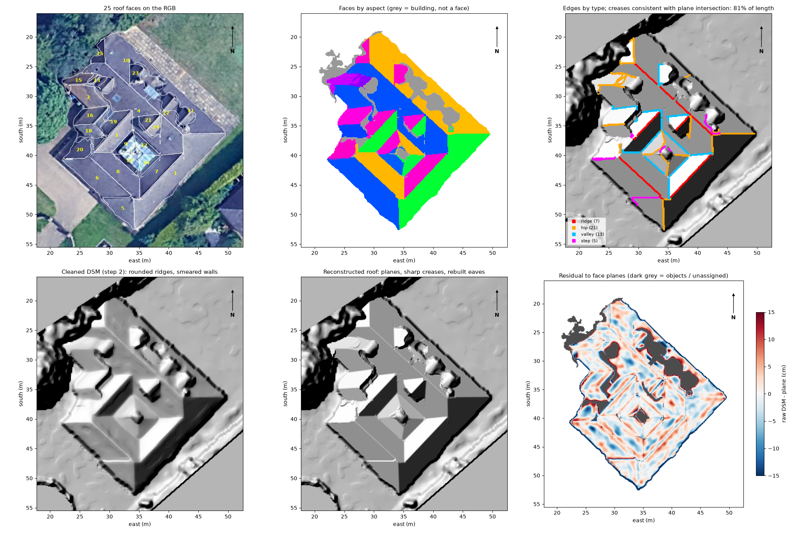
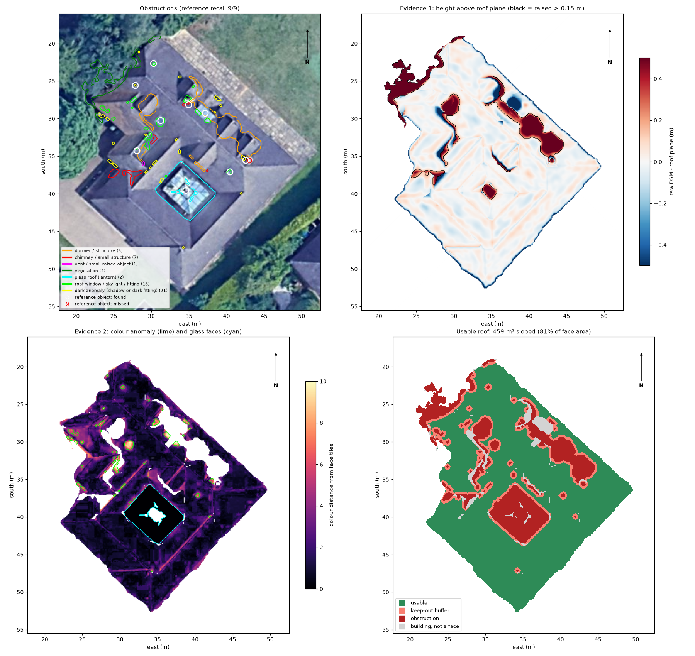
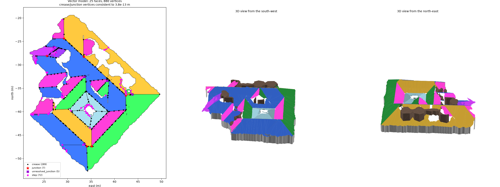

# Roof Reconstruction & Solar Panel Placement

Rebuilds a geometrically consistent 3D roof from a **Digital Surface Model (DSM)** and **RGB aerial
imagery**, finds rooftop obstructions (chimneys, skylights, roof windows), and places standard-size
solar panels on the usable roof area.


## Results at a glance

| | |
|---|---|
| Roof faces | **25 planar faces**, plane RMSE median 2.6 cm; sharp ridges/eaves rebuilt (synthetic: creases 6.8 → <1 cm) |
| Obstructions | dormers, chimneys, vents, roof windows, skylights, glass lantern; **9/9** hand-labelled objects found |
| Usable roof | 459 m² sloped (81 % of face area) after a 0.3 m keep-out around obstructions |
| 3D model | vector model, neighbouring faces consistent to 4·10⁻¹³ m; PLY / GLB / GeoJSON / interactive HTML |
| Panels | **45 × 430 Wp = 19.35 kWp**, ≈ 18,400 kWh/yr (first-order) on 6 suitable SE/SW faces |
| Layout checks | 0 overlaps, gap ≥ 0.02 m, edge setback ≥ 0.30 m, 0 raster violations |
| Quality | 110 tests; slope/aspect match GDAL to 4·10⁻⁶°; one command, ≈ 47 s |

## Deliverables

| Brief item | Where |
|---|---|
| Python source | `src/roofsolar/` (package), `scripts/` (entry points), `tests/` |
| README: setup, dependencies, how to run | this file: [Setup](#setup), [Requirements](#requirements), [Running the solution](#running-the-solution) |
| Visual results: roof, obstructions, panels | [`outputs/`](outputs) (figures, GeoTIFFs, GeoJSON, 3D models; see [Outputs](#outputs)) |
| Brief technical explanation | [`docs/technical_report.md`](docs/technical_report.md) (approach, algorithms, assumptions, limitations, incomplete tasks) |
| Detailed evidence per step | [`docs/progress.md`](docs/progress.md) |

---

## Contents
1. [Pipeline overview](#pipeline-overview)
2. [Repository structure](#repository-structure)
3. [Requirements](#requirements)
4. [Setup](#setup)
5. [Input data](#input-data)
6. [Running the solution](#running-the-solution)
7. [Outputs](#outputs)
8. [Configuration](#configuration)
9. [Testing & code quality](#testing--code-quality)
10. [Technical explanation](#technical-explanation)
11. [Pipeline status](#pipeline-status)

---

## Pipeline overview

```
 DSM + RGB
    │
    ▼
 1. Terrain analysis ── Horn slope/aspect (true north), ground model, height above ground
    │
    ▼
 2. Cleaning ────────── TGV² regularisation, biharmonic hole filling, spike removal
    │
    ▼
 3. Roof faces ──────── region growing → robust TLS planes → merging → k-planes (sharp creases)
    │
    ▼
 4. Obstructions ────── height above plane + per-face colour anomaly + glass test → keep-out
    │
    ▼
 5. 3D model ────────── noded coverage → plane-intersection snapping → mesh + walls + objects
    │
    ▼
 6. Solar layout ────── irradiation-based suitability → DP row packing in face-plane coordinates
```

## Repository structure

```
.
├── configs/
│   └── default.yaml        # every threshold and parameter (no magic numbers in code)
├── data/
│   ├── raw/                # input rasters (read-only)
│   └── reference/          # hand-labelled rooftop objects (recall check only)
├── docs/
│   ├── Technical Assessment.pdf
│   ├── technical_report.md # brief technical explanation
│   └── progress.md         # per-step log: decisions, evidence, results
├── outputs/                # essential results per step (regenerated by the pipeline)
├── scripts/                # command-line entry points
├── src/roofsolar/          # library: one module per pipeline stage
│   ├── raster_io.py        #   reading, grid validation, alignment, writing
│   ├── terrain.py          #   step 1: gradients, slope, aspect, ground, noise
│   ├── cleaning.py         #   step 2: TGV², fill, outliers, vegetation index
│   ├── faces.py            #   step 3: segmentation, planes, adjacency
│   ├── obstructions.py     #   step 4: raised / flush / glass detection, usable mask
│   ├── model3d.py          #   step 5: vector model, consistent vertices, mesh
│   ├── solar.py, panels.py #   step 6: irradiation model, placement
│   ├── synthetic.py        #   synthetic roofs with ground truth (tests, benchmarks)
│   ├── pipeline.py         #   step runners (inputs → outputs, stats, figures)
│   └── viz.py              #   figures
├── tests/                  # pytest unit tests
├── pyproject.toml          # package metadata, dependencies, tool config
└── requirements.txt        # exact pinned versions for reproducibility
```

## Requirements

- **Python 3.10 to 3.12** (developed and tested on 3.12.13).
- macOS / Linux / Windows
- [`uv`](https://docs.astral.sh/uv/) recommended (plain `pip` also works)

Main dependencies:

| Package | Used for |
|---|---|
| `numpy`, `scipy` | array maths, filtering, interpolation, least squares, distance transforms |
| `rasterio` | GeoTIFF I/O, CRS / geotransforms, polygonising and rasterising |
| `scikit-image` | morphology, labelling, biharmonic inpainting, CIELAB conversion, Otsu threshold, TV baseline (benchmark) |
| `scikit-learn` | robust colour covariance (Minimum Covariance Determinant) for flush obstructions |
| `shapely` (GEOS ≥ 3.12) | polygons, coverage simplification, constrained Delaunay triangulation, panel geometry |
| `trimesh` | mesh export (PLY / OBJ / GLB) |
| `matplotlib`, `plotly` | figures and interactive 3D HTML viewers |
| `pyyaml` | configuration |

`open3d` and `opencv-python-headless` are listed in `pyproject.toml` / `requirements.txt` from the
initial setup, but the final pipeline does not use them. They are kept so the pinned environment
stays unchanged, and can be removed.

The full pinned list is in [`requirements.txt`](requirements.txt).

## Setup

```bash
# 1. Clone
git clone https://github.com/ShafHaider007/powerlabs_assessment.git
cd powerlabs_assessment

# 2. Create and activate a virtual environment
uv venv --python 3.12 .venv
source .venv/bin/activate          # Windows: .venv\Scripts\activate

# 3. Install (editable package + dev tools)
uv pip install -e ".[dev]"
```

<details>
<summary>Without uv (plain pip)</summary>

```bash
python3.12 -m venv .venv
source .venv/bin/activate
pip install -r requirements.txt     # exact versions
pip install -e . --no-deps
```
</details>

Check the install:

```bash
python -c "import roofsolar, rasterio, shapely, skimage; print('ok')"
```

## Input data

Stored in `data/raw/`, all on the same 0.1 m grid in **WGS 84 / UTM zone 30N (EPSG:32630)**:

| File | Description | Size (px) | NoData |
|---|---|---|---|
| `dsm_clipped.tif` | DSM clipped to the property parcel: house, garden, part of a tree (heights in m) | 757 × 623 | -9999 |
| `dsm_full.tif` | DSM of the full scene | 797 × 802 | none |
| `rgb.tif` | RGB orthophoto, aligned with `dsm_full.tif` | 797 × 802 | 0 |

## Running the solution

```bash
source .venv/bin/activate

# Full pipeline: steps 1-6 (about 47 s), outputs in outputs/stepNN_*/
python scripts/run_pipeline.py

# Selected steps, or a custom config (a step re-runs the previous one if it is not selected)
python scripts/run_pipeline.py --steps 1 2
python scripts/run_pipeline.py --config configs/my_config.yaml

# Cross-check slope/aspect against GDAL (needs gdaldem; QGIS's copy is found automatically)
python scripts/validate_terrain_gdal.py

# Re-create the evidence behind the step-2 choices (filter comparison, hole-fill test)
python scripts/benchmark_cleaning.py --noise realistic

# Step-3 evidence: accuracy on a synthetic roof + stability on the real roof
python scripts/validate_faces.py

# Step-4 evidence: threshold sensitivity (recall vs usable area)
python scripts/validate_obstructions.py

# Step-6 evidence: placement sensitivity (setback, suitability, panel size, strategy)
python scripts/validate_panels.py
```

## Outputs

Each step writes to its own `outputs/stepNN_*` folder. The **essential results are committed**
(figures, key GeoTIFFs, JSON statistics, GeoJSON, 3D models, validation results). Intermediate
rasters and duplicate mesh formats are written when the pipeline runs but are not published.
GeoTIFFs keep the input georeferencing and open directly in QGIS. The `.glb` models open in any
3D viewer; the `.html` viewers must be downloaded and opened in a browser (GitHub shows HTML
as source).

**Step 1: terrain (`outputs/step01_terrain/`)**

| File | Content |
|---|---|
| `slope.tif`, `aspect.tif` | slope (deg, Horn's method) and aspect (deg clockwise from **true** north; NaN where flat) |
| `ndsm.tif` | height above ground (m) |
| `stats.json` | grid, noise estimates, flat threshold, roof aspect peaks |
| `00_summary.png`, `02_slope.png`, `03_aspect.png`, `06_data_provenance.png` | figures |


**Step 2: noise and missing data (`outputs/step02_cleaning/`)**

| File | Content |
|---|---|
| `dsm_clean.tif` | regularised DSM (TGV², outliers / missing pixels re-filled) |
| `stats.json` | before/after noise metrics, outliers, solver convergence |
| `benchmark/` | filter comparison and hole-fill hold-out test (evidence for the method choice) |
| `00_summary.png`, `01_profiles.png`, `03_noise_reduction.png` | figures |


**Step 3: roof faces (`outputs/step03_faces/`)**

| File | Content |
|---|---|
| `faces.tif` | face labels (0 = not a roof face) |
| `planar.tif` | reconstructed roof: each face pixel at its plane height |
| `faces.json` | per face: area (plan and sloped), slope, aspect, RMSE, plane `z = aE + bN + c` |
| `edges.json` | ridge / hip / valley / step edges and their consistency with plane intersections |
| `validation/validation.json` | synthetic accuracy and stability results |
| `00_summary.png`, `01_stages.png`, `02_profiles.png` | figures |



**Step 4: obstructions (`outputs/step04_obstructions/`)**

| File | Content |
|---|---|
| `obstructions.tif` | obstruction class per pixel (dormer, chimney, vent, vegetation, glass, roof window, dark anomaly) |
| `usable.tif` | usable roof = faces − obstructions − 0.3 m keep-out |
| `obstructions.json` | every object (class, evidence, confidence, area, height) and usable area per face |
| `validation/sensitivity.json` | threshold sensitivity (recall vs usable area) |
| `00_summary.png` | figure |



**Step 5: 3D model (`outputs/step05_model3d/`)**

| File | Content |
|---|---|
| `roof_model.glb` | coloured 3D mesh: planar roof faces, walls, obstruction prisms (local metres; origin in `model_metadata.json`) |
| `roof_model.html` | interactive 3D viewer (download and open in a browser) |
| `roof_faces_3d.geojson` | 3D face polygons in EPSG:32630 with slope, aspect, area (opens in QGIS) |
| `stats.json` | consistency checks: crease/junction gaps, planarity, simplification error |
| `00_summary.png` | figure |



**Step 6: panels (`outputs/step06_panels/`)**

| File | Content |
|---|---|
| `panels.geojson` | every panel as a 3D polygon (EPSG:32630) with face, orientation, estimated kWh/yr |
| `roof_with_panels.glb`, `roof_with_panels.html` | 3D roof with panels (mesh and interactive viewer) |
| `faces.json` | per face: relative solar yield, suitability (and why not), panels, strategy comparison, checks |
| `stats.json` | totals (panels, kWp, kWh/yr) and automated geometric checks |
| `validation/sensitivity.json` | sensitivity to setback, suitability threshold, panel size, strategy |
| `overview.png`, `00_summary.png`, `01_3d_panels.png` | figures |


## Configuration

All parameters (slope limits, obstruction height threshold, panel dimensions, setbacks, ...) live in
[`configs/default.yaml`](configs/default.yaml). To run with different settings, copy the file and
pass it with `--config`.

## Testing & code quality

```bash
pytest              # unit tests
ruff check .        # lint
ruff format .       # format
```

## Technical explanation

**[`docs/technical_report.md`](docs/technical_report.md)** gives the approach, key algorithms and
why they were chosen, assumptions, a validation summary, limitations and incomplete tasks.
[`docs/progress.md`](docs/progress.md) has the detailed log of every step: data findings,
alternatives compared, bugs found and fixed, and all validation numbers.

## Pipeline status

| Step | Status |
|---|---|
| 1. Terrain analysis (elevation, slope, aspect) | ✅ |
| 2. Cleaning (noise, missing data) | ✅ |
| 3. Roof face segmentation & plane fitting | ✅ |
| 4. Obstruction detection | ✅ |
| 5. 3D roof model | ✅ |
| 6. Solar panel placement | ✅ |
| 7. Validation & write-up | ✅ |
