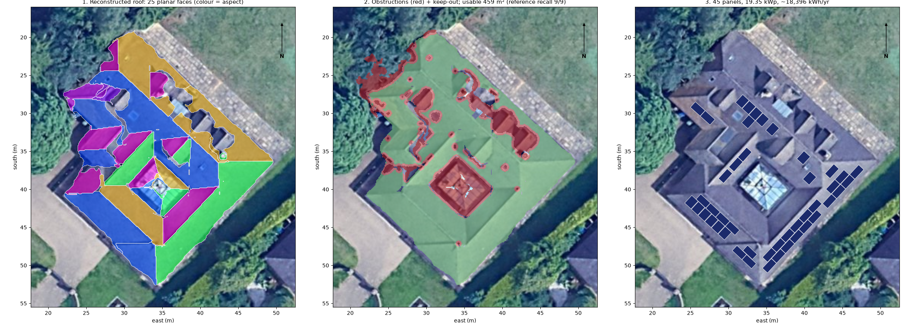

# Technical Explanation: 3D Roof Reconstruction & Solar Panel Placement

**Input:** DSM (10 cm, EPSG:32630, property clip + full tile) and an aligned RGB orthophoto.
**Output:** slope/aspect, a cleaned DSM, 25 planar roof faces, an obstruction map, a vector 3D roof model and a validated layout of **45 panels (19.35 kWp, ≈18,400 kWh/yr)**.
**Run:** `python scripts/run_pipeline.py` (≈47 s). The detailed per-step log with all evidence is in [`progress.md`](progress.md).

## 1. Approach

The pipeline has six steps. Each one is driven by **measurements of this data** rather than by default parameters, and each has tests and a validation script.

| # | Step | Core method | Key result |
|---|---|---|---|
| 1 | Elevation, slope, aspect | Horn (1981) 3×3 gradients on the full tile, cropped to the AOI; linear-extrapolation edges; aspect rotated to **true north** (grid convergence +1.63°); morphological ground model → height above ground | matches **GDAL gdaldem to 4·10⁻⁶°** (after removing gdaldem's float32 rounding, traced and proven) |
| 2 | Noise & missing data | **TGV²** regularisation (piecewise-planar prior, Chambolle–Pock primal-dual); biharmonic hole filling; local Hampel + amplitude-relative isolation test for spikes | roof-face normal scatter **3.0° → 1.25°**; fill method chosen by hold-out test; 95 % spike recall (100 % on the roof) |
| 3 | Roof faces | plane-aware region growing on normals → robust **total-least-squares** planes → greedy coplanar merging → **k-planes** reassignment (rebuilds sharp creases on plane intersections) → eave reconstruction; ridge/hip/valley/step classification | 25 faces, RMSE median 2.6 cm; synthetic creases **6.8 → <1 cm**, eaves **146 → <1 cm**; plane change ≤ 0.16° under perturbation |
| 4 | Obstructions | raised: raw DSM height above the face plane (> 0.15 m = 3.5σ); flush: CIELAB **Mahalanobis** colour distance to the same face's tiles (MCD covariance) + compactness filter; glass faces: glazing contrast **and** specular brightness | **9/9** hand-labelled objects found; usable roof 459 m² (81 %) |
| 5 | 3D model | polygonise → **node** → topology-preserving **coverage simplification** → crease vertices snapped onto plane-intersection lines, junctions onto the planes' common point → constrained Delaunay mesh + walls + object prisms | consistency **4·10⁻¹³ m**, planarity **1·10⁻¹⁴ m** (measured) |
| 6 | Panels | suitability from a first-order **annual irradiation model** (NOAA sun, two-state sky, Erbs, isotropic transposition); packing in each face's **plane frame** (true sloped distances) by **dynamic programming over row heights** with optimal greedy rows | 45 panels; 0 overlaps, gap ≥ 0.02 m, setback ≥ 0.30 m, **0 raster violations** |

## 2. Key algorithms and why

- **Horn gradients:** the Sobel-type operator has about 40 % less noise than central differences (0.43σ/d vs 0.71σ/d, unit-tested), and it is the GIS standard, which made an exact external cross-check possible.
- **TGV² instead of Gaussian/median/bilateral/TV:** roofs are flat planes meeting at sharp creases, which is exactly TGV²'s prior.
  - On a synthetic roof degraded with the **noise model measured from this DSM** (blurred edges, 2.5 cm waviness at 0.25 m correlation), TGV² was the only filter that substantially cleaned the faces (1.2° vs ≥ 3.6°) without worsening the walls.
  - The first noise model (pixel noise) proved wrong on real data and was rebuilt from measurements.
- **Plane-aware region growing:** each pixel is compared with the region's fitted plane, not with its neighbour, because the provider's smoothing turned creases into gradual bends.
- **Total least squares:** minimises perpendicular rather than vertical distances, so it is unbiased on steep faces. The robust version iterates with the threshold centred on the median residual.
- **Greedy agglomerative merging:** union-find chained non-coplanar faces through a third segment and lost two large faces in a stability test (a 75° plane error). Merging one best pair at a time, re-evaluated on the real union, fixed it (≤ 0.16°).
- **k-planes assignment:** on a rounded crease the closest-plane switch happens where the planes are equal, i.e. on their intersection line, so sharp ridges and valleys are rebuilt. Real data shows the expected signs: ridges +3.5 cm, valleys −4.3 cm against the raw DSM.
- **Two evidence types for obstructions:** height for raised objects; colour (per-face location, robust covariance) for flush roof windows; a face-level glazing test for the glass lantern.
  - Shadows and dark fittings are colour-identical here, so recall was favoured by asymmetric cost: a false keep-out costs about 5 % area, while a missed flue under a panel is an installation failure.
- **Exact 3D consistency:** the plan line where z_a = z_b is linear, so crease vertices are projected onto it. Junctions solve (NᵀN)p = Nᵀd, which is exact for three planes. A noding step was needed because the polygonizer drops collinear T-junction vertices.
- **DP packing:** for identical panels on a line, earliest-feasible greedy is optimal (interval scheduling). Rows that do not overlap are independent, so DP over row start heights gives the **optimum over all row-based layouts** at 5 cm resolution: 45 panels vs 39 for an aligned grid.

## 3. Assumptions

- DSM heights and pixel sizes are in metres (the projected CRS is checked).
- `dsm_clipped` is the property AOI.
- Roofs are piecewise planar.
- The noise model and thresholds are measured from this DSM; another sensor or provider would need the scripted benchmarks re-run.
- Footprint wall line at 1.5 m above ground (the steepest point of the smeared walls).
- Obstruction thresholds:
  - raised objects: 0.15 m (3.5 × raw noise)
  - colour distance: 5, the highest value with full recall
  - keep-out: 0.3 m, the measured smear width
- Panel: 1.722 × 1.134 m, 430 Wp; flush-mounted, rows parallel to the eave; 2 cm gap; **0.3 m setback** from every face edge.
- A face is suitable when its annual irradiation is ≥ **75 %** of the site optimum (SE/SW ≈ 0.95 pass; NE/NW ≈ 0.64 do not); slope ≤ 60°; not glass.
- Energy: first-order sky model calibrated to central England (GHI ≈ 1050 kWh/m², diffuse ≈ 49 %), PR 0.80, **no shading**.

## 4. Validation summary

- **110 unit / end-to-end tests:** synthetic surfaces with exact answers, adjoint tests of the TGV operators, analytic hip-roof vertices, packing optima, geometric layout checks.
- **External reference:** slope/aspect agree with GDAL gdaldem.
- **Hold-out and planted-error tests:** hole filling, 150 planted spikes.
- **Hand-labelled obstructions:** 9 reference objects.
- **Stability:** 10 runs with 1 mm perturbations.
- **Sensitivity scripts** for steps 2, 4 and 6 (`scripts/benchmark_cleaning.py`, `validate_faces.py`, `validate_obstructions.py`, `validate_panels.py`).

## 5. Limitations and incomplete tasks

- **Shading is not part of the placement.** The hourly sun path is used only to rank faces by orientation and tilt. A separate ray-casting check estimated the effect of shading:
  - Method: from each of the 45 panel centres, for every daylight hour of the year, march a ray toward the sun over the full-tile DSM; beam light is lost when any DSM height exceeds the ray.
  - Result: annual energy loss is **11.5 % on average** (median 9.9 %, max 28.2 %). 22 panels lose > 10 % and 2 lose > 20 % (face 2, west wing, near the tree). The SW faces lose 15–16 % and the long SE face 5.9 %.
  - Caveats: beam light only (diffuse sky obstruction ignored); the tile ends ~40 m from the house, so distant trees are missed; raw-DSM noise can add small false hits at grazing sun.
  - Next step: exclude roof areas above ~20 % annual loss before packing and report shading-corrected energy (≈ 11 % below the current estimate).
- **Energy is a first-order estimate:** two-state sky, isotropic diffuse. Production would use PVGIS or measured irradiance.
- **Edges the data cannot resolve:**
  - Shadows vs dark fittings are not separable from one RGB image (handled conservatively).
  - Adjacent dormers merge, because the provider's smoothing bridges ~1 m gaps.
  - Some west-wing labels (chimney vs dormer part) are uncertain.
  - Recall is measured on only 9 hand-labelled objects; precision is not measured.
- **Roof geometry:**
  - 81 % of crease length matches plane intersections. The rest is in the cluttered west wing, on the glass lantern, and between nearly parallel planes (judged with an uncertainty-aware threshold).
  - 5 junctions where three planes meet far from where the faces meet are left unresolved (gaps of 9–42 cm) rather than distorting faces.
  - Small clutter faces vary between runs (23–26 faces); large faces are stable.
- **3D model:**
  - The outline is the simplified pixel boundary, not regularised to straight orthogonal walls.
  - Objects are LOD1 prisms.
  - The model is not a closed solid.
- **Panels:**
  - Rows parallel to the eave only.
  - One uniform setback for all edge types (real codes vary by edge).
  - The region keeps the pixel staircase (conservative by ≤ half a pixel).
  - The edge setback is the most sensitive parameter: 0.2 m → 54 panels, 0.4 m → 33.
- **Runtime:** TGV dominates (36 s, pure NumPy); a GPU/numba port would be needed for city-scale use.
